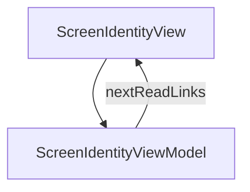

# ScreenIdentity - Screen identity and navigation assertion

## Overview

Concept essay: what a screen is, how its id is derived, the runtime marker, and how a test asserts 'this screen is displayed'. Covers screen id = layout basename (recursive collection, project-wide uniqueness, variant normalization), the four-step classification order (explicit role > referenced as cell/header/footer/cellClasses/include > partial:true > default screen) and `jui screens` read-back, app-owned screens via test.appOwnedScreens, the __screen_<id> marker (dedicated node, exactly one per rendered screen, sibling of the scrollable, centred on the root, clear of the Android system-bar window, dev-build gating per platform), the assert:"screen" vocabulary with `name` as target key, implicit verification on flow screen changes (verifyScreenTransitions / screenTransitionTimeout / four failure classes), the five validator rules, and the measured limits (web hydration gap, suspending transitions, no exclusivity form). Eight H2 sections + TOC + next-reads. ~8-min read. Canonical source: shared/core/screen_identity.json.

| | |
|---|---|
| Layout File | `concepts/screen-identity` |
| Created | 2026-07-27 |
| Updated | 2026-07-27 |

## Screen Structure

### UI Components

| Component | ID | Platform | Description | Initial State | Notes |
|---|---|---|---|---|---|
| View | `concepts_screen_identity_root` | - | - | - | - |
| &nbsp;&nbsp;↳ Scroll | `concepts_screen_identity_scroll` | - | - | - | - |
| &nbsp;&nbsp;&nbsp;&nbsp;↳ View | `concepts_screen_identity_header` | - | - | - | - |
| &nbsp;&nbsp;&nbsp;&nbsp;&nbsp;&nbsp;↳ Label | `-` | - | - | - | - |
| &nbsp;&nbsp;&nbsp;&nbsp;&nbsp;&nbsp;↳ Label | `-` | - | - | - | - |
| &nbsp;&nbsp;&nbsp;&nbsp;&nbsp;&nbsp;↳ Label | `-` | - | - | - | - |
| &nbsp;&nbsp;&nbsp;&nbsp;&nbsp;&nbsp;↳ Label | `-` | - | - | - | - |
| &nbsp;&nbsp;&nbsp;&nbsp;↳ View | `concepts_screen_identity_content_with_rail` | - | - | - | - |
| &nbsp;&nbsp;&nbsp;&nbsp;&nbsp;&nbsp;↳ View | `concepts_screen_identity_body_column` | - | - | - | - |
| &nbsp;&nbsp;&nbsp;&nbsp;&nbsp;&nbsp;&nbsp;&nbsp;↳ View | `section_problem` | - | - | - | - |
| &nbsp;&nbsp;&nbsp;&nbsp;&nbsp;&nbsp;&nbsp;&nbsp;&nbsp;&nbsp;↳ Label | `-` | - | - | - | - |
| &nbsp;&nbsp;&nbsp;&nbsp;&nbsp;&nbsp;&nbsp;&nbsp;&nbsp;&nbsp;↳ Label | `-` | - | - | - | - |
| &nbsp;&nbsp;&nbsp;&nbsp;&nbsp;&nbsp;&nbsp;&nbsp;&nbsp;&nbsp;↳ CodeBlock | `-` | - | - | - | - |
| &nbsp;&nbsp;&nbsp;&nbsp;&nbsp;&nbsp;&nbsp;&nbsp;↳ View | `section_id` | - | - | - | - |
| &nbsp;&nbsp;&nbsp;&nbsp;&nbsp;&nbsp;&nbsp;&nbsp;&nbsp;&nbsp;↳ Label | `-` | - | - | - | - |
| &nbsp;&nbsp;&nbsp;&nbsp;&nbsp;&nbsp;&nbsp;&nbsp;&nbsp;&nbsp;↳ Label | `-` | - | - | - | - |
| &nbsp;&nbsp;&nbsp;&nbsp;&nbsp;&nbsp;&nbsp;&nbsp;&nbsp;&nbsp;↳ Label | `-` | - | - | - | - |
| &nbsp;&nbsp;&nbsp;&nbsp;&nbsp;&nbsp;&nbsp;&nbsp;&nbsp;&nbsp;↳ Label | `-` | - | - | - | - |
| &nbsp;&nbsp;&nbsp;&nbsp;&nbsp;&nbsp;&nbsp;&nbsp;&nbsp;&nbsp;↳ Label | `-` | - | - | - | - |
| &nbsp;&nbsp;&nbsp;&nbsp;&nbsp;&nbsp;&nbsp;&nbsp;↳ View | `section_classification` | - | - | - | - |
| &nbsp;&nbsp;&nbsp;&nbsp;&nbsp;&nbsp;&nbsp;&nbsp;&nbsp;&nbsp;↳ Label | `-` | - | - | - | - |
| &nbsp;&nbsp;&nbsp;&nbsp;&nbsp;&nbsp;&nbsp;&nbsp;&nbsp;&nbsp;↳ Label | `-` | - | - | - | - |
| &nbsp;&nbsp;&nbsp;&nbsp;&nbsp;&nbsp;&nbsp;&nbsp;&nbsp;&nbsp;↳ CodeBlock | `-` | - | - | - | - |
| &nbsp;&nbsp;&nbsp;&nbsp;&nbsp;&nbsp;&nbsp;&nbsp;&nbsp;&nbsp;↳ Label | `-` | - | - | - | - |
| &nbsp;&nbsp;&nbsp;&nbsp;&nbsp;&nbsp;&nbsp;&nbsp;&nbsp;&nbsp;↳ Label | `-` | - | - | - | - |
| &nbsp;&nbsp;&nbsp;&nbsp;&nbsp;&nbsp;&nbsp;&nbsp;↳ View | `section_marker` | - | - | - | - |
| &nbsp;&nbsp;&nbsp;&nbsp;&nbsp;&nbsp;&nbsp;&nbsp;&nbsp;&nbsp;↳ Label | `-` | - | - | - | - |
| &nbsp;&nbsp;&nbsp;&nbsp;&nbsp;&nbsp;&nbsp;&nbsp;&nbsp;&nbsp;↳ Label | `-` | - | - | - | - |
| &nbsp;&nbsp;&nbsp;&nbsp;&nbsp;&nbsp;&nbsp;&nbsp;&nbsp;&nbsp;↳ CodeBlock | `-` | - | - | - | - |
| &nbsp;&nbsp;&nbsp;&nbsp;&nbsp;&nbsp;&nbsp;&nbsp;&nbsp;&nbsp;↳ Label | `-` | - | - | - | - |
| &nbsp;&nbsp;&nbsp;&nbsp;&nbsp;&nbsp;&nbsp;&nbsp;&nbsp;&nbsp;↳ Label | `-` | - | - | - | - |
| &nbsp;&nbsp;&nbsp;&nbsp;&nbsp;&nbsp;&nbsp;&nbsp;&nbsp;&nbsp;↳ Label | `-` | - | - | - | - |
| &nbsp;&nbsp;&nbsp;&nbsp;&nbsp;&nbsp;&nbsp;&nbsp;&nbsp;&nbsp;↳ Label | `-` | - | - | - | - |
| &nbsp;&nbsp;&nbsp;&nbsp;&nbsp;&nbsp;&nbsp;&nbsp;↳ View | `section_assert` | - | - | - | - |
| &nbsp;&nbsp;&nbsp;&nbsp;&nbsp;&nbsp;&nbsp;&nbsp;&nbsp;&nbsp;↳ Label | `-` | - | - | - | - |
| &nbsp;&nbsp;&nbsp;&nbsp;&nbsp;&nbsp;&nbsp;&nbsp;&nbsp;&nbsp;↳ Label | `-` | - | - | - | - |
| &nbsp;&nbsp;&nbsp;&nbsp;&nbsp;&nbsp;&nbsp;&nbsp;&nbsp;&nbsp;↳ CodeBlock | `-` | - | - | - | - |
| &nbsp;&nbsp;&nbsp;&nbsp;&nbsp;&nbsp;&nbsp;&nbsp;&nbsp;&nbsp;↳ Label | `-` | - | - | - | - |
| &nbsp;&nbsp;&nbsp;&nbsp;&nbsp;&nbsp;&nbsp;&nbsp;↳ View | `section_implicit` | - | - | - | - |
| &nbsp;&nbsp;&nbsp;&nbsp;&nbsp;&nbsp;&nbsp;&nbsp;&nbsp;&nbsp;↳ Label | `-` | - | - | - | - |
| &nbsp;&nbsp;&nbsp;&nbsp;&nbsp;&nbsp;&nbsp;&nbsp;&nbsp;&nbsp;↳ Label | `-` | - | - | - | - |
| &nbsp;&nbsp;&nbsp;&nbsp;&nbsp;&nbsp;&nbsp;&nbsp;&nbsp;&nbsp;↳ Label | `-` | - | - | - | - |
| &nbsp;&nbsp;&nbsp;&nbsp;&nbsp;&nbsp;&nbsp;&nbsp;&nbsp;&nbsp;↳ Label | `-` | - | - | - | - |
| &nbsp;&nbsp;&nbsp;&nbsp;&nbsp;&nbsp;&nbsp;&nbsp;&nbsp;&nbsp;↳ Label | `-` | - | - | - | - |
| &nbsp;&nbsp;&nbsp;&nbsp;&nbsp;&nbsp;&nbsp;&nbsp;&nbsp;&nbsp;↳ Label | `-` | - | - | - | - |
| &nbsp;&nbsp;&nbsp;&nbsp;&nbsp;&nbsp;&nbsp;&nbsp;&nbsp;&nbsp;↳ Label | `-` | - | - | - | - |
| &nbsp;&nbsp;&nbsp;&nbsp;&nbsp;&nbsp;&nbsp;&nbsp;↳ View | `section_validation` | - | - | - | - |
| &nbsp;&nbsp;&nbsp;&nbsp;&nbsp;&nbsp;&nbsp;&nbsp;&nbsp;&nbsp;↳ Label | `-` | - | - | - | - |
| &nbsp;&nbsp;&nbsp;&nbsp;&nbsp;&nbsp;&nbsp;&nbsp;&nbsp;&nbsp;↳ Label | `-` | - | - | - | - |
| &nbsp;&nbsp;&nbsp;&nbsp;&nbsp;&nbsp;&nbsp;&nbsp;&nbsp;&nbsp;↳ CodeBlock | `-` | - | - | - | - |
| &nbsp;&nbsp;&nbsp;&nbsp;&nbsp;&nbsp;&nbsp;&nbsp;&nbsp;&nbsp;↳ Label | `-` | - | - | - | - |
| &nbsp;&nbsp;&nbsp;&nbsp;&nbsp;&nbsp;&nbsp;&nbsp;↳ View | `section_limits` | - | - | - | - |
| &nbsp;&nbsp;&nbsp;&nbsp;&nbsp;&nbsp;&nbsp;&nbsp;&nbsp;&nbsp;↳ Label | `-` | - | - | - | - |
| &nbsp;&nbsp;&nbsp;&nbsp;&nbsp;&nbsp;&nbsp;&nbsp;&nbsp;&nbsp;↳ Label | `-` | - | - | - | - |
| &nbsp;&nbsp;&nbsp;&nbsp;&nbsp;&nbsp;&nbsp;&nbsp;&nbsp;&nbsp;↳ Label | `-` | - | - | - | - |
| &nbsp;&nbsp;&nbsp;&nbsp;&nbsp;&nbsp;&nbsp;&nbsp;&nbsp;&nbsp;↳ Label | `-` | - | - | - | - |
| &nbsp;&nbsp;&nbsp;&nbsp;&nbsp;&nbsp;&nbsp;&nbsp;&nbsp;&nbsp;↳ Label | `-` | - | - | - | - |
| &nbsp;&nbsp;&nbsp;&nbsp;&nbsp;&nbsp;&nbsp;&nbsp;↳ View | `concepts_screen_identity_next` | - | - | - | - |
| &nbsp;&nbsp;&nbsp;&nbsp;&nbsp;&nbsp;&nbsp;&nbsp;&nbsp;&nbsp;↳ Label | `-` | - | - | - | - |
| &nbsp;&nbsp;&nbsp;&nbsp;&nbsp;&nbsp;&nbsp;&nbsp;&nbsp;&nbsp;↳ Collection | `concepts_screen_identity_next_collection` | - | - | - | - |
| &nbsp;&nbsp;&nbsp;&nbsp;&nbsp;&nbsp;&nbsp;&nbsp;↳ View | `concepts_screen_identity_footer` | - | - | - | - |
| &nbsp;&nbsp;&nbsp;&nbsp;&nbsp;&nbsp;&nbsp;&nbsp;&nbsp;&nbsp;↳ Label | `-` | - | - | - | - |
| &nbsp;&nbsp;&nbsp;&nbsp;&nbsp;&nbsp;↳ View | `concepts_screen_identity_rail_column` | - | - | - | - |
| &nbsp;&nbsp;&nbsp;&nbsp;&nbsp;&nbsp;&nbsp;&nbsp;↳ View | `concepts_screen_identity_toc_wrap` | - | - | - | - |
| &nbsp;&nbsp;&nbsp;&nbsp;&nbsp;&nbsp;&nbsp;&nbsp;&nbsp;&nbsp;↳ TableOfContents | `-` | - | - | - | - |

### Layout Structure

```
concepts_screen_identity_root
└── concepts_screen_identity_scroll
```

## Data Flow



### ViewModel

#### Methods

| Signature | Platforms | Description |
|---|---|---|
| `onAppear()` | all | Seed nextReadLinks from the module-scope catalog (three rows: next_testing -> /guides/testing, next_composition -> /concepts/screen-composition, next_responsive -> /concepts/responsive-design). Each row's titleKey / descriptionKey is resolved through StringManager with the concepts_screen_identity_ namespace prefix. |
| `onNavigate(url: String)` | all | router.push(url). |

## State Management

### UI Data Variables

| Variable Name | Type | Default | Description | Notes |
|---|---|---|---|---|
| `nextReadLinks` | [NextReadLink] | `-` | Three follow-up cards: guides/testing (the wider DSL), concepts/screen-composition (co-present screens) and concepts/responsive-design (variants share an id). | - |

### View-local Event Handlers

_Handlers kept inside the View layer. ViewModel public API lives under `dataFlow.viewModel`._

| Handler | Description | Notes |
|---|---|---|
| `onAppear` | Seed nextReadLinks. | - |
| `onNavigate` | Client-side navigation. | - |
| `onNavigateConcepts` |  | - |

## User Actions

| Action | Processing | Destination | Notes |
|---|---|---|---|
| Tap a TOC entry | TOC-internal scroll. | - | - |
| Tap a NextReadLink card | onNavigate(url). | - | - |

## Validation

## Transitions

| Condition | Destination | Notes |
|---|---|---|
| url is a spec-mapped concept URL or the testing guide | Target spec screen or tab | - |

## Related Files

| Type | File Path | Notes |
|---|---|---|
| Layout | `docs/screens/layouts/concepts/screen-identity.json` | - |
| ViewModel | `jsonui-doc-web/src/viewmodels/concepts/ScreenIdentityViewModel.ts` | - |
| View | `jsonui-doc-web/src/app/concepts/screen-identity/page.tsx` | - |

## Notes

- 2026-07-27 — New page for the screen-identity track (canonical asset shared/core/screen_identity.json, libraries SwiftJsonUI / KotlinJsonUI, drivers ios / android / web — implicit verification is ON by default; marker placement: SwiftJsonUI uses a centre overlay and KotlinJsonUI an inset past the system-bar window, and the iOS predicate has a second clause).
- Eight H2 sections + TOC + next-reads (3 cards).
- Section 1 — section_problem: why probing for an element on the destination is fragile; the whole assertion is { assert: 'screen', name: '<id>' }.
- Section 2 — section_id: id = layout basename; recursive collection minus the Resources/Styles subtrees (screenId.nonLayoutSubtrees), project-wide uniqueness (screen-id-collision), variant files normalize to the base id.
- Section 3 — section_classification: four-step resolution order + `jui screens` read-back + app-owned screens (test.appOwnedScreens, hand-written data-screen on web).
- Section 4 — section_marker: dedicated node __screen_<id>, per-platform mechanism table, exactly-one invariant, sibling-of-scrollable placement, dev-build gating.
- Section 5 — section_assert: target key is `name` (not the step-level `screen`), non-exclusive semantics, marker means constructed not settled.
- Section 6 — section_implicit: implicit verification scope + tracker rules, screenTransitionTimeout 10000, four failure classes (a class names the cause, not a severity — all fail through the ordinary assertion path), verifyScreenTransitions ON by default with the rebuild-first rollout and the per-platform pin-propagation caveat.
- Section 7 — section_validation: the five validator rules; --no-install for inspection; role-then-steps ordering warning.
- Section 8 — section_limits: web hydration gap, suspending transitions, no exclusivity assertion.
- Every claim is taken from the canonical screen_identity.json and its measured evidence; nothing here is inferred from the implementation report alone.
- 2026-07-31 — marker-absent bullet extended: the Android and web drivers name the likeliest culprit in the failure message. Android distinguishes another app owning the foreground (system dialog, stuck picker) from stale generated code — the stale-codegen hint only appears when the app under test is frontmost; web appends the current URL, which surfaces auth redirects. Source: 2026-07-31-platform-truth-mcp-and-inbox-three.md §5.
- 2026-08-25 — the app-owned paragraph mirrors the canon's added sentence — having no layout is what these screens are, not an omission, which is why the spec-coverage check passes over them (nothing to carry a role, nothing for the spec to describe). The canon gained that sentence because the declaration acquired a new reader; the page follows for the same reason.
- 2026-09-01 — section_marker_bullet_debug gains the web readiness gate in jsonui-test-runner-web: the marker is not only an assertion target but the gate that decides a screen is ready. Sourced by reading the published artifact rather than the release note: npm pack of the published version was unpacked and read — waitForScreenReady in dist/runner/JsonUITestRunner.js for the three strategies, the forced-networkidle notice, the announced fallback and the thrown error under 'marker'; screenIdFromLayout for the id rule (basename, drop .json, cut at the last @). The published sentences say only what those files do. This face is unaffected operationally and that is measured too: no package.json here depends on the driver and nothing executes the 32 screen tests — they are validated by jsonui-test validate and never run — so the production-bundle caveat is published for readers rather than acted on locally.
- 2026-09-01 — the readiness tail on this page. Read from the published driver package: waitForScreenReady resolves `declared ?? this.config.screenReadyStrategy`, so a file's own declaration outranks the project switch; 'none' and the object form return early with their own notice; the object form waits for the marker it names rather than the id from source.layout. Counted the announcing outcomes rather than asserting 'all': four of five print on stderr, and an explicitly declared "auto" is the fifth — it reaches the same else-branch as declaring nothing, which calls log(), which is gated on config.verbose. Publishing 'every non-default outcome announces' would have been the plausible-sounding version and would have been wrong. Separately, jsonui-cli has a version handshake; measured in a scratch fixture with a fabricated node_modules manifest, one variable per arm: a driver too old for the declaration -> ERROR + exit 1; newer versions -> silent, compared numerically, not lexicographically; a pre-release suffix -> silent, because parse_version drops it; no installed package -> WARN naming it as unchecked + exit 0. Two negative arms are on the page because they change what a reader concludes from silence: a file with no screenReady is not warned even with a too-old driver (opt-in by declaration), and a file carrying any other validation error is excluded from the check entirely (cli.py passes valid_test_files), so an unrelated fix is what surfaces the version error.
- 2026-09-01 — two additions. The pre-release acceptance has a documented reason, and the page says both the reason and that it was recorded after the behaviour was measured and questioned rather than designed in, because the difference decides how much a reader should build on it. Worth recording how that reason arrived: this lane filed the behaviour with a guess at the rationale, explicitly labelled a guess, and upstream answered that it was not the intent and then adopted the guess as the intent. The label is what made that safe — a flat assertion would have had the other lane read this lane's sentence instead of recalling its own reasoning. The page carried only mechanism and consequence in the meantime, which is why nothing needed retracting. Second addition: the unreadable-version warning is split in two — with no config and no enclosing checkout, it says no project root could be resolved and names --config or running from the project root. Verified from outside against a fixture, with the source tree each arm ran asserted first (checking for the guard string in the module source), after an earlier A/B in this repo silently ran the same tool on both sides.

<!-- jsonui-doc-producer: jsonui-doc:spec -->
