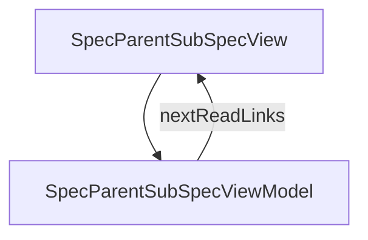

# SpecParentSubSpec - Parent + sub specs

## Overview

Pattern 2 of spec splitting — deep dive into screen_parent_spec + screen_sub_spec. The parent is a pure container: every behavioural section is supplied by the sub-specs and declaring one in the parent is an error. Covers the parent's remaining fields, what a sub owns (including branchContracts beside the method it constrains), a merger-derived table of where each section goes, the keyed-vs-concatenated merge rules and where a conflict is reported, and a migration section for parents written earlier.

| | |
|---|---|
| Layout File | `spec/parent-sub-spec` |
| Created | 2026-04-24 |
| Updated | 2026-08-28 |

## Screen Structure

### UI Components

| Component | ID | Platform | Description | Initial State | Notes |
|---|---|---|---|---|---|
| View | `spec_parent_sub_spec_root` | - | - | - | - |
| &nbsp;&nbsp;↳ Scroll | `spec_parent_sub_spec_scroll` | - | - | - | - |
| &nbsp;&nbsp;&nbsp;&nbsp;↳ View | `spec_parent_sub_spec_header` | - | - | - | - |
| &nbsp;&nbsp;&nbsp;&nbsp;&nbsp;&nbsp;↳ Label | `-` | - | - | - | - |
| &nbsp;&nbsp;&nbsp;&nbsp;&nbsp;&nbsp;↳ Label | `-` | - | - | - | - |
| &nbsp;&nbsp;&nbsp;&nbsp;&nbsp;&nbsp;↳ Label | `-` | - | - | - | - |
| &nbsp;&nbsp;&nbsp;&nbsp;&nbsp;&nbsp;↳ Label | `-` | - | - | - | - |
| &nbsp;&nbsp;&nbsp;&nbsp;↳ View | `spec_parent_sub_spec_body` | - | - | - | - |
| &nbsp;&nbsp;&nbsp;&nbsp;&nbsp;&nbsp;↳ View | `section_when` | - | - | - | - |
| &nbsp;&nbsp;&nbsp;&nbsp;&nbsp;&nbsp;&nbsp;&nbsp;↳ Label | `-` | - | - | - | - |
| &nbsp;&nbsp;&nbsp;&nbsp;&nbsp;&nbsp;&nbsp;&nbsp;↳ Label | `-` | - | - | - | - |
| &nbsp;&nbsp;&nbsp;&nbsp;&nbsp;&nbsp;↳ View | `section_parent` | - | - | - | - |
| &nbsp;&nbsp;&nbsp;&nbsp;&nbsp;&nbsp;&nbsp;&nbsp;↳ Label | `-` | - | - | - | - |
| &nbsp;&nbsp;&nbsp;&nbsp;&nbsp;&nbsp;&nbsp;&nbsp;↳ Label | `-` | - | - | - | - |
| &nbsp;&nbsp;&nbsp;&nbsp;&nbsp;&nbsp;&nbsp;&nbsp;↳ CodeBlock | `-` | - | - | - | - |
| &nbsp;&nbsp;&nbsp;&nbsp;&nbsp;&nbsp;↳ View | `section_sub` | - | - | - | - |
| &nbsp;&nbsp;&nbsp;&nbsp;&nbsp;&nbsp;&nbsp;&nbsp;↳ Label | `-` | - | - | - | - |
| &nbsp;&nbsp;&nbsp;&nbsp;&nbsp;&nbsp;&nbsp;&nbsp;↳ Label | `-` | - | - | - | - |
| &nbsp;&nbsp;&nbsp;&nbsp;&nbsp;&nbsp;&nbsp;&nbsp;↳ CodeBlock | `-` | - | - | - | - |
| &nbsp;&nbsp;&nbsp;&nbsp;&nbsp;&nbsp;↳ View | `section_inherited` | - | - | - | - |
| &nbsp;&nbsp;&nbsp;&nbsp;&nbsp;&nbsp;&nbsp;&nbsp;↳ Label | `-` | - | - | - | - |
| &nbsp;&nbsp;&nbsp;&nbsp;&nbsp;&nbsp;&nbsp;&nbsp;↳ Label | `-` | - | - | - | - |
| &nbsp;&nbsp;&nbsp;&nbsp;&nbsp;&nbsp;&nbsp;&nbsp;↳ CodeBlock | `-` | - | - | - | - |
| &nbsp;&nbsp;&nbsp;&nbsp;&nbsp;&nbsp;↳ View | `section_merge` | - | - | - | - |
| &nbsp;&nbsp;&nbsp;&nbsp;&nbsp;&nbsp;&nbsp;&nbsp;↳ Label | `-` | - | - | - | - |
| &nbsp;&nbsp;&nbsp;&nbsp;&nbsp;&nbsp;&nbsp;&nbsp;↳ Label | `-` | - | - | - | - |
| &nbsp;&nbsp;&nbsp;&nbsp;&nbsp;&nbsp;&nbsp;&nbsp;↳ CodeBlock | `-` | - | - | - | - |
| &nbsp;&nbsp;&nbsp;&nbsp;&nbsp;&nbsp;↳ View | `section_migrate` | - | - | - | - |
| &nbsp;&nbsp;&nbsp;&nbsp;&nbsp;&nbsp;&nbsp;&nbsp;↳ Label | `-` | - | - | - | - |
| &nbsp;&nbsp;&nbsp;&nbsp;&nbsp;&nbsp;&nbsp;&nbsp;↳ Label | `-` | - | - | - | - |
| &nbsp;&nbsp;&nbsp;&nbsp;&nbsp;&nbsp;&nbsp;&nbsp;↳ Label | `-` | - | - | - | - |
| &nbsp;&nbsp;&nbsp;&nbsp;&nbsp;&nbsp;&nbsp;&nbsp;↳ CodeBlock | `-` | - | - | - | - |
| &nbsp;&nbsp;&nbsp;&nbsp;&nbsp;&nbsp;&nbsp;&nbsp;↳ Label | `-` | - | - | - | - |
| &nbsp;&nbsp;&nbsp;&nbsp;&nbsp;&nbsp;&nbsp;&nbsp;↳ Label | `-` | - | - | - | - |
| &nbsp;&nbsp;&nbsp;&nbsp;&nbsp;&nbsp;↳ View | `section_antipatterns` | - | - | - | - |
| &nbsp;&nbsp;&nbsp;&nbsp;&nbsp;&nbsp;&nbsp;&nbsp;↳ Label | `-` | - | - | - | - |
| &nbsp;&nbsp;&nbsp;&nbsp;&nbsp;&nbsp;&nbsp;&nbsp;↳ Label | `-` | - | - | - | - |
| &nbsp;&nbsp;&nbsp;&nbsp;↳ View | `spec_parent_sub_spec_next` | - | - | - | - |
| &nbsp;&nbsp;&nbsp;&nbsp;&nbsp;&nbsp;↳ Label | `-` | - | - | - | - |
| &nbsp;&nbsp;&nbsp;&nbsp;&nbsp;&nbsp;↳ Label | `-` | - | - | - | - |
| &nbsp;&nbsp;&nbsp;&nbsp;&nbsp;&nbsp;↳ Collection | `spec_parent_sub_spec_next_collection` | - | - | - | - |
| &nbsp;&nbsp;&nbsp;&nbsp;↳ View | `spec_parent_sub_spec_footer` | - | - | - | - |
| &nbsp;&nbsp;&nbsp;&nbsp;&nbsp;&nbsp;↳ Label | `-` | - | - | - | - |

### Layout Structure

```
spec_parent_sub_spec_root
└── spec_parent_sub_spec_scroll
```

## Data Flow



### ViewModel

#### Methods

| Signature | Platforms | Description |
|---|---|---|
| `onAppear()` | all | Seed nextReadLinks from NEXT_READ_ENTRIES. |
| `onNavigate(url: String)` | all | router.push. |

#### Vars

| Declaration | Flags | Platforms | Description |
|---|---|---|---|
| `var nextReadLinks: Array(NextReadLink)` | observable | all | Closing cards. |

## State Management

### UI Data Variables

| Variable Name | Type | Default | Description | Notes |
|---|---|---|---|---|
| `nextReadLinks` | [NextReadLink] | `-` | Follow-up cards. | - |

### View-local Event Handlers

_Handlers kept inside the View layer. ViewModel public API lives under `dataFlow.viewModel`._

| Handler | Description | Notes |
|---|---|---|
| `onAppear` | Seed nextReadLinks. | - |
| `onNavigate` | Client-side navigation. | - |
| `onNavigateSpec` |  | - |

## User Actions

| Action | Processing | Destination | Notes |
|---|---|---|---|
| Tap a NextReadLink card | onNavigate(url). | - | - |

## Validation

## Transitions

| Condition | Destination | Notes |
|---|---|---|
| url is /spec/layout-file or /spec/component-spec | Target spec screen | - |

## Related Files

| Type | File Path | Notes |
|---|---|---|
| Layout | `docs/screens/layouts/spec/parent-sub-spec.json` | - |
| ViewModel | `jsonui-doc-web/src/viewmodels/spec/ParentSubSpecViewModel.ts` | - |
| View | `jsonui-doc-web/src/app/spec/parent-sub-spec/page.tsx` | - |

## Notes

- Phase 2 article 2/5: the parent + sub split. Uses ~6 sections to walk through why + how + what validator enforces + what jui build merges.
- No live examples of this pattern inside JsonUIDocument yet — the CodeBlocks are illustrative (a Home screen with Feed + Notifications sub regions).
- 2026-08-28 — rewritten after measuring the merger directly: a parent declaring dataFlow.viewModel / repositories / stateManagement.uiVariables / userActions produced four errors with the move-it wording (quoted on the page); two subs declaring the same method identically merged to one entry and validate passed; the same method declared differently produced `dataFlow.viewModel.methods[name=send]: Defined differently in 'ChatCore' and 'ChatStreaming'` from the merger and nothing from validate spec, which is why the page says which tool sees a conflict; the parent's structure.notes survived the merge and notes concatenated parent-first.
- The migration section states that output is expected to grow rather than match, because the parent's declarations were being discarded before. Upstream had circulated the opposite (delete them, the merged output is byte-identical) and corrected it; the page is written so a reader who deletes instead of moving is warned before they do it.
- 2026-08-31 — section_merge_body corrected: this page listed branchContracts among the name-keyed sections, and that was the intent rather than the behaviour. Measured on a two-sub fixture sharing no contract name via ParentSpecMerger.merge_from_file: the merge returns both conditions and both methods with no conflict. The discriminating case is published with it — adding a same-named condition with different wording reports exactly one conflict keyed branchContracts.conditions[name=hasDraft], because a merge that never conflicts would equally be a merge that never descended.
- 2026-09-04 - unitContracts joins the two lists on this page (what lives in a sub-spec, and what the merger keys by name). Verified in the merger rather than taken from the notice: the block is read from each sub and keyed at (target, case name), one level deeper than branchContracts, so several sub-specs may add cases to the same target and only a same-named case with different content is reported as a conflict. The doc validator has a closed-vocabulary check for the section, so `jsonui-doc validate spec` catches a misspelled key.
- 2026-09-04 - this page's first list has a canonical source: shared/core/parent_spec_rules.py's MERGER_BUILDS_FROM_SUB_SPECS, which an upstream test walks through a real merge so the set and the merger cannot drift. The prose is NOT derived from it - the sentence groups sections editorially and two of the eleven names (relatedFiles, notes) are read from the parent too, so they belong in a different sentence - but an eleventh CI gate checks coverage: every canonical section must be named somewhere in this namespace. Measured four ways before it was trusted: green as it stands (11 of 11), red with one name removed from the prose, refusing when the toolchain has no rules module, green again. The refusal message branches on whether a section has a destination at all, and that distinction is in the migrate bullet: default-deny refusal plus hand-written construction means a section can be refused in the parent and read by nobody in the sub, which happened twice.
- 2026-09-04 - `validation` is in MERGER_BUILDS_FROM_SUB_SPECS (12 names), and the eleventh gate went red naming it when it was added, before anything else here noticed. Measured where it belongs rather than assuming: it is NOT in PARENT_READS_TOP_LEVEL, so it is a section that must move to a sub-spec and belongs in the behaviour sentence; and the merger keys it inside each of its two subsections - clientSide on `field`, serverSide on `condition` - so it belongs in the merge-keying list too, with that detail.
- 2026-09-04, page-convention ruling asked of this lane and answered (a): the generated page for a parent spec is an INDEX, not a merged view. Measured first, independently of the notice: document_tools imports the merger 0 times while jui_tools' build, verify, generate and repository_aggregator all do, and the HTML generator renders an explicit Sub Specifications table - so the shape is deliberate, not an oversight. The deciding argument is that a merged parent page would teach what the toolchain refuses: a reader seeing Data Flow and Validation on the parent's page opens the parent spec to find them, and declaring one there is a default-deny error. Secondary: two renderings of one declaration drift apart when only one is regenerated, which is the class this lane has spent the week on. Two conditions attached: the parent page must SAY that behaviour lives on the sub pages (absence is only legible where it is stated), and the Sub Specifications table should carry a column naming the sections each sub supplies, so the index can answer 'which page has validation?' without duplicating anything. Stated with the standing declared: this site has zero split screens, so the ruling is editorial, not experiential.
- 2026-09-04 - the sub-spec index has a Declares column, and one premise this lane asserted while asking for it was wrong. I wrote that the generator 'already opens the sub files to make links, so the column can be derived from their top-level keys'; reading the generator showed it did not - the link was `sub_file.replace('.spec.json', '.html').split('/')[-1]`, pure string work, zero file reads near that table. The column needed a spec directory threaded through, which upstream added. Verified the result on a fixture built here (one parent, two subs): the Declares column lists exactly the behaviour sections each sub declares, a `notes` key planted as a decoy in one sub does NOT appear (bookkeeping keys are excluded), the parent page carries the sentence saying behaviour is declared in the subs and documented on their pages, and markdown carries both. Both CLI modes pass the directory.

<!-- jsonui-doc-producer: jsonui-doc:spec -->
