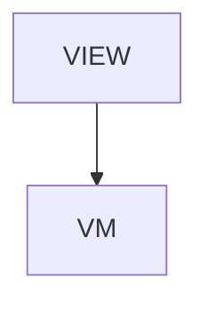

# Viz - jui viz: watch your agents work

## Overview

Tools > jui viz. Since 2026-10-24 a short page pointing at the /viz section (one article per feature), which the former long article was split into. One card per article.

| | |
|---|---|
| Layout File | `tools/viz` |
| Created | 2026-10-18 |
| Updated | 2026-10-24 |

## Screen Structure

### UI Components

| Component | ID | Platform | Description | Initial State | Notes |
|---|---|---|---|---|---|
| View | `tools_viz_root` | - | - | - | - |
| &nbsp;&nbsp;↳ Scroll | `tools_viz_scroll` | - | - | - | - |
| &nbsp;&nbsp;&nbsp;&nbsp;↳ View | `tools_viz_header` | - | - | - | - |
| &nbsp;&nbsp;&nbsp;&nbsp;&nbsp;&nbsp;↳ Label | `-` | - | - | - | - |
| &nbsp;&nbsp;&nbsp;&nbsp;&nbsp;&nbsp;↳ Label | `-` | - | - | - | - |
| &nbsp;&nbsp;&nbsp;&nbsp;&nbsp;&nbsp;↳ Label | `-` | - | - | - | - |
| &nbsp;&nbsp;&nbsp;&nbsp;↳ View | `section_moved` | - | - | - | - |
| &nbsp;&nbsp;&nbsp;&nbsp;&nbsp;&nbsp;↳ Label | `-` | - | - | - | - |
| &nbsp;&nbsp;&nbsp;&nbsp;&nbsp;&nbsp;↳ Label | `-` | - | - | - | - |
| &nbsp;&nbsp;&nbsp;&nbsp;&nbsp;&nbsp;↳ Collection | `tools_viz_articles_collection` | - | - | - | - |
| &nbsp;&nbsp;&nbsp;&nbsp;↳ View | `tools_viz_footer` | - | - | - | - |
| &nbsp;&nbsp;&nbsp;&nbsp;&nbsp;&nbsp;↳ Label | `-` | - | - | - | - |

### Layout Structure

```
tools_viz_root
└── tools_viz_scroll
```

## Data Flow



### ViewModel

#### Methods

| Signature | Platforms | Description |
|---|---|---|
| `onAppear()` | all | Seed articleLinks from the static catalog of the /viz section (eleven rows). Each row's titleKey / descriptionKey is resolved through StringManager with the tools_viz_ namespace prefix. |
| `onNavigate(url: String)` | all | Client-side navigation via router.push(url). Destinations: /tools, /viz, /viz/setup, /viz/codex, /viz/room, /viz/spirits, /viz/panels, /viz/sessions, /viz/messages, /viz/approvals, /viz/tests, /viz/server-room, /viz/infra-model, /viz/cost. |

#### Vars

| Declaration | Flags | Platforms | Description |
|---|---|---|---|
| `var articleLinks: Array(NextReadLink)` | observable | all | One card per /viz article. Seeded on appear and re-seeded on a language change. |

## State Management

### UI Data Variables

| Variable Name | Type | Default | Description | Notes |
|---|---|---|---|---|
| `articleLinks` | [NextReadLink] | `-` | One card per /viz article. | - |

### View-local Event Handlers

_Handlers kept inside the View layer. ViewModel public API lives under `dataFlow.viewModel`._

| Handler | Description | Notes |
|---|---|---|
| `onAppear` | Seed articleLinks. | - |
| `onNavigate` | Client-side navigation. | - |
| `onNavigateTools` |  | - |

## User Actions

| Action | Processing | Destination | Notes |
|---|---|---|---|
| Tap an article card | onNavigate(url). | - | - |

## Validation

## Transitions

| Condition | Destination | Notes |
|---|---|---|
| url is spec-mapped | Target screen or tab | - |

## Related Files

| Type | File Path | Notes |
|---|---|---|
| Layout | `docs/screens/layouts/tools/viz.json` | - |
| ViewModel | `jsonui-doc-web/src/viewmodels/tools/VizViewModel.ts` | - |
| View | `jsonui-doc-web/src/app/tools/viz/page.tsx` | - |

## Notes

- The article this page used to hold lives in the /viz section (docs/screens/json/viz/). The live demo moved to /viz.

<!-- jsonui-doc-producer: jsonui-doc:spec -->
